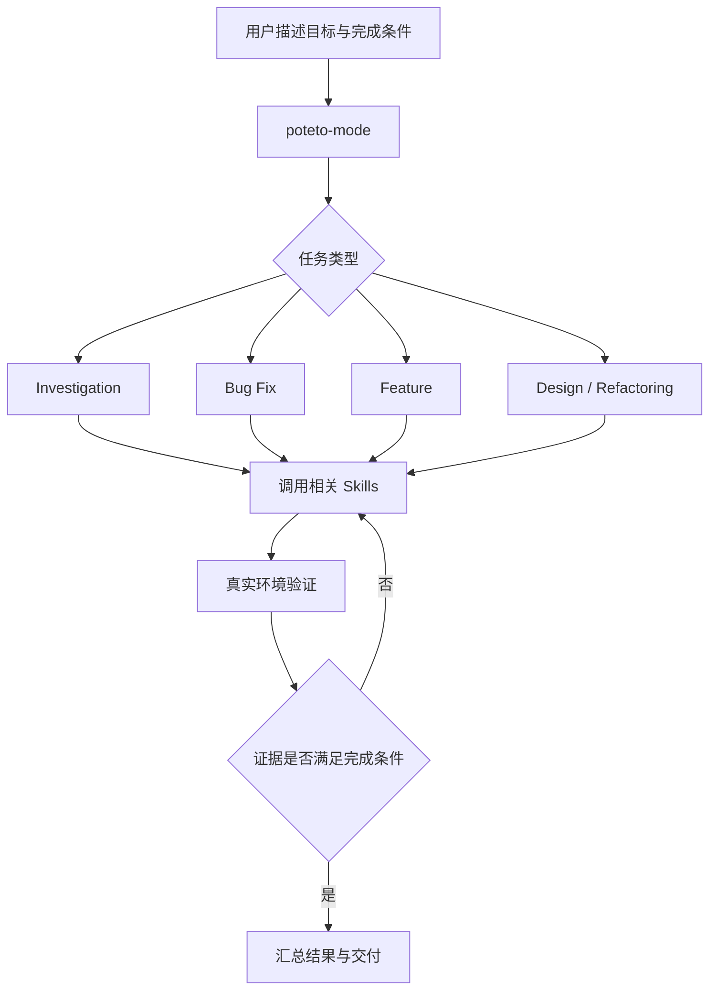

# P-Stack 总体架构分析

> 本文是基于上游 README、插件元数据、用户指南和核心 Skill 的中文研究笔记。描述上游事实时附上来源；架构图是对多个文件的归纳，不是上游官方架构图。

## 1. P-Stack 是什么

P-Stack 是一套面向软件工程任务的 Agent 工作流与技能集合。它并不是一个基础模型，也不等同于一个独立的多 Agent 运行时。它把工程任务的做法编码为 Skills、Playbooks、Principles、Agents、Automations 和辅助脚本，再由主要入口 `poteto-mode` 按任务需要组织调用。

上游 README 强调的目标不是最大化代码产量，而是提高代码质量、可验证性和并行工作的可信度。

来源：
- [P-Stack README](https://github.com/cursor/plugins/blob/main/pstack/README.md)
- [插件元数据](https://github.com/cursor/plugins/blob/main/pstack/plugin.json)
- [用户指南](https://github.com/cursor/plugins/tree/main/pstack/docs/guide)

## 2. 概念分层

| 层次 | 上游构件 | 主要职责 |
|---|---|---|
| 入口与路由 | `poteto-mode` | 理解任务目标，选择 Playbook，组织步骤 |
| 流程模板 | Playbooks | 把调查、修复、功能、重构、验证、交付等任务拆成阶段 |
| 可复用能力 | Skills | 封装特定任务的操作规程与约束 |
| 工程约束 | Principles | 将设计、编码、调试和验证原则变成可引用规则 |
| 执行角色 | Agents / Subagents | 承担受限范围内的独立工作 |
| 自动化与工具 | Automations / Scripts | 支撑重复执行、环境操作和流程集成 |
| 质量闭环 | Eval / Verification / Interrogate | 检验 Agent 输出和真实软件行为 |

## 3. 典型工作流

这是基于 README 和 Playbook 说明归纳的逻辑模型。实际执行能力还依赖宿主环境提供的工具、子 Agent 能力、模型和权限。

## 4. 为什么采用 Playbook

Skill 回答“如何完成某类具体工作”；Playbook 回答“一个完整任务应按什么顺序推进、何时调用哪些能力、什么条件下才能结束”。

例如，Bug Fix Playbook 的关键思路是先复现、定位根因，再修改并验证，而不是看到症状就直接加保护分支。Feature Playbook 则强调先明确数据形状和行为边界，再实现和验证。

Playbook 让主 Agent 不必每次临时发明流程，也让执行过程更容易审查。

## 5. 模型与角色解耦

`setup-pstack` 的职责是配置不同角色使用的模型和推理预算。其配置写入 Cursor 用户规则文件，供相关 Skill 读取。由此可以看出：角色定义与具体模型选择是分开的。

迁移到多模型工作台时，应保留这一抽象：

- Role：开发、架构、审查、评估等职责。
- Model：承担该职责的具体模型。
- Runtime：执行 Agent 的环境，例如 Codex CLI 或其他 Agent 框架。
- Tool permissions：该角色能访问的文件、命令和外部系统。

不要把某个模型名称硬编码成角色本身。

## 6. 对本地多模型工作台的启发

建议采用以下逻辑组件，而不是复制 Cursor 专有命令：

1. **任务入口**：用户提交目标、约束、验收条件。
2. **Orchestrator**：识别任务类型并选择工作流。
3. **Role Registry**：维护 Agent 角色与模型映射。
4. **Workflow Registry**：维护 Playbook。
5. **Execution Adapter**：适配 Codex CLI、模型 API 和本地工具。
6. **Evidence Store**：保存命令输出、测试结果、差异和评审记录。
7. **Eval Runner**：对固定任务集运行模型或 Skill 对比。

这属于本项目的迁移设计建议，并非 P-Stack 自带的通用工作台实现。

## 7. 需要继续核验

- `poteto-mode/SKILL.md` 中完整的路由规则、子 Agent 生命周期和权限边界。
- 各 Playbook 的阶段、分支条件和终止条件。
- `setup-pstack` 对模型 slug、推理预算和 panel 的具体处理。
- Cursor 与 Claude Code 适配层的能力差异。
- 自动化与脚本如何支撑长期运行。
