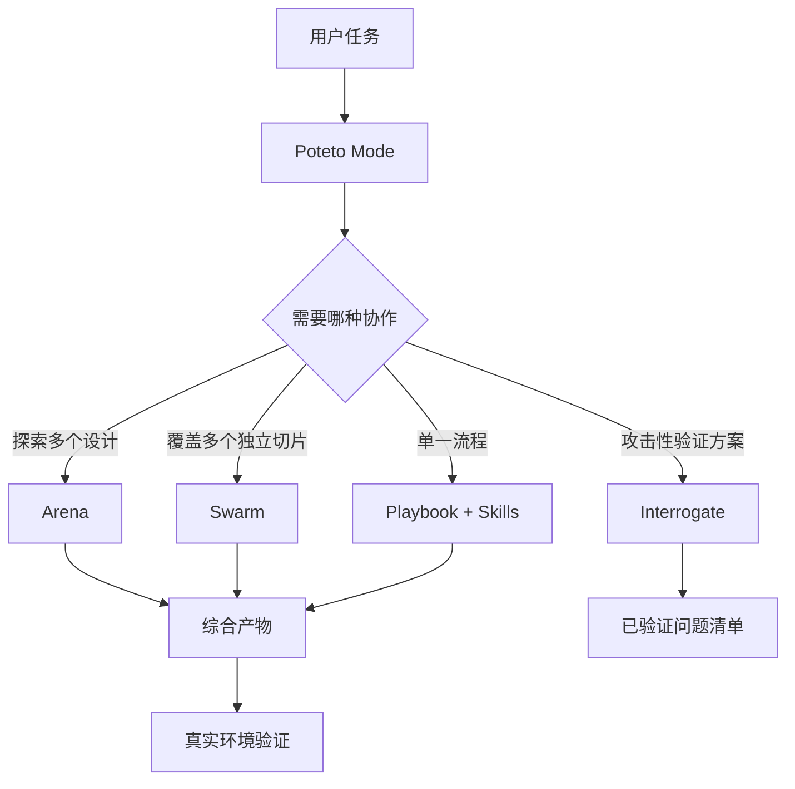

# Agent 协作机制：Poteto Mode、Arena、Swarm 与 Interrogate

## 1. 先区分四种职责

| 构件 | 解决的问题 | 协作模式 |
|---|---|---|
| Poteto Mode | 这个任务应该怎样组织？ | 主 Agent 路由与协调 |
| Arena | 多个方案中哪些设计更好？ | 同题并行、交叉评审、综合 |
| Swarm | 如何覆盖多个独立工作切片？ | 分工并行、汇总 |
| Interrogate | 现有方案是否存在可证明的问题？ | 多视角对抗式验证 |

## 2. Poteto Mode：统一入口

上游 README 和指南将 `poteto-mode` 定义为主要入口。用户给出目标后，它匹配相应 Playbook，将步骤放入待办列表，并在步骤需要时调用其他 Skills。

重要设计点：
- 用户描述目标和完成条件，不必预先指定每个 Skill。
- Playbook 提供任务阶段，Skill 提供阶段所需的具体能力。
- 跳过步骤时应说明原因，而不是让流程看起来完整但实际漏做。
- 主会话持有任务流程和协调责任，子 Agent 负责被分配的工作。

来源：[poteto-mode Skill](https://github.com/cursor/plugins/blob/main/pstack/skills/poteto-mode/SKILL.md)。

## 3. Arena：同题竞争

Arena 适合设计空间较大、一次尝试容易过早锁定方案的任务。

上游流程可归纳为：
1. 明确每个候选需要交付的产物。
2. 制定 3–6 条可判定的评分标准。
3. 让多个候选在隔离目录或 worktree 中执行同一任务。
4. 在适用时使用不同模型家族的交叉评审者。
5. 选择一个候选作为基础，吸收其他候选的有效部分。
6. 对综合后的结果重新验证。

关键不是简单投票，而是“独立探索 + 有标准的比较 + 人工/协调者综合 + 再验证”。

来源：[Arena Skill](https://github.com/cursor/plugins/blob/main/pstack/skills/arena/SKILL.md)。

## 4. Swarm：分工并行

Swarm 适合可以拆成互相独立切片的任务，例如：
- 每个子系统分别检查一组接口；
- 每个目录分别执行静态检查；
- 不同 Agent 分别调查不同日志或调用链。

上游 Swarm 将流程分为 Frame、Fan out、Aggregate、Report：
- Frame：定义完成条件、任务切片和产物。
- Fan out：并行启动工作者，每个工作者有独立范围和输出。
- Aggregate：检查结果是否覆盖全部切片，缺失结果不能算通过。
- Report：统一汇总 PASS、ISSUES、BLOCKED 及证据。

来源：[Swarm Skill](https://github.com/cursor/plugins/blob/main/pstack/skills/swarm/SKILL.md)。

## 5. Interrogate：对抗式审查

Interrogate 的目标不是让审查 Agent 提供一长串猜测，而是要求每个问题通过真实运行证据成立，例如失败测试、复现脚本或命令输出。它强调只保留被验证的发现，不负责直接修复。

来源：[Interrogate Skill](https://github.com/cursor/plugins/blob/main/pstack/skills/interrogate/SKILL.md)。

## 6. 四者如何组合

## 7. 对 Codex + 多模型工作台的迁移建议

建议不要一开始就实现复杂的“Agent 自主组队”。先实现三个清晰的执行原语：

- `delegate(task, scope, output)`：分配独立子任务。
- `race(task, candidates, rubric)`：同题多方案比较。
- `review(target, threat_model, evidence_required)`：对抗审查并要求证据。

每个子任务都应明确：
- 输入上下文和允许读取的目录；
- 是否允许写入；
- 唯一输出位置；
- 验收命令；
- 结果状态；
- 证据和未解决问题。

并行写代码时优先使用独立 worktree 或独立分支，避免多个 Agent 同时修改同一工作区。

## 8. 风险与边界

- 并行不必然更快：模型调用、上下文整理和合并成本可能更高。
- 同模型多次运行不等于独立审查；模型家族、提示和上下文的相关性需要考虑。
- Judge 也会出错，关键发现应由人或可执行检查复核。
- 没有证据的“PASS”不算验证通过。
- 子 Agent 的权限应小于或等于主任务实际授权范围。
