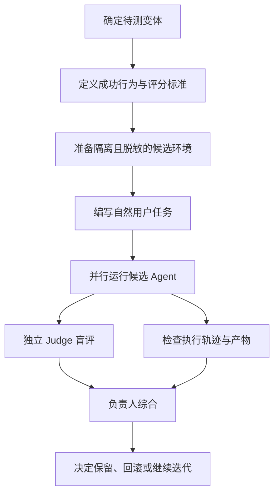

# Eval：Agent 与 Skill 的盲测评估

## 1. Eval 是什么

在 P-Stack 中，Eval Playbook 用于评估 Skill 或提示词变更是否改变了 Agent 的实际行为。它不是只检查文本是否符合格式，也不是让模型简单给自己的回答打分。

其核心思路是：设计一个真实任务，让不同候选在尽量相同的条件下执行，再由独立评审者根据预先制定的标准评估结果。

来源：[Eval Playbook](https://github.com/cursor/plugins/blob/main/pstack/skills/poteto-mode/playbooks/eval.md)。

## 2. 上游 Eval 的关键要求

### 2.1 先定义成功标准

实验设计者先明确正在测试的变体，以及什么行为算成功。评分标准通常包含 3–6 条具体、可判定的标准，并只提供给 Judge，不暴露给候选 Agent。

### 2.2 候选任务应自然

候选看到的提示词应像真实用户请求，只描述目标，不提示“这是测试”“请展示你使用了哪些原则”等元信息。避免候选为了迎合评分而表演。

### 2.3 环境隔离与脱敏

每个候选使用独立工作目录，放置其正常工作时自然会看到的项目上下文。目录名、文件名和候选标签应脱敏；不告知候选还有其他候选参与。

### 2.4 独立 Judge

Judge 可以知道自己在评估，但只看到脱敏后的候选结果，不看到模型名称。比较两个版本时，尽可能由同一个 Judge 在同一轮、同一尺度下评价，且不知道哪份结果来自哪个版本。

### 2.5 检查真实执行轨迹

上游强调不能只相信候选自述。需要检查工作区内的 Agent transcript，确认候选实际打开了哪些文件，再结合代码形态和最终产物判断其是否遵循了预期工作方式。

### 2.6 人工综合结论

实验负责人应完整阅读每个候选的输出，并与 Judge 结论对照。如果两者不一致，需要判断是 Judge 偏差还是评分标准含糊，再形成最终结论。

## 3. Eval 流程

## 4. 为什么要盲测

若候选知道自己正在测试某条规则，可能会刻意提及规则名称或输出看似合规的说明，却没有真正改变工作行为。若 Judge 知道模型身份，也可能受品牌印象影响。

盲测不能消除所有偏差，但能降低部分提示泄漏和身份偏见。

## 5. 一个适用于 BMC 的 Eval 示例

待测变体：改进一个用于分析 Lua RPC 超时问题的 Skill。

自然任务提示：
> 设备上的跨板配置同步偶发超时。请调查调用链，给出最可能的根因、支持证据和下一步验证方法。暂时不要修改代码。

Judge 的评分标准（仅评估者可见）：
1. 是否从调用入口追踪到实际 RPC 调用点；
2. 是否区分日志直接证据与推断；
3. 是否检查超时、重试和阻塞语义；
4. 是否定位到具体文件、函数或配置；
5. 是否提出可执行且有判别力的验证步骤；
6. 是否避免未经证实的根因断言。

可比较的候选变体：
- A：现有 Skill；
- B：增加调用链追踪规则；
- C：增加证据分级与反证要求。

注意：三个候选必须使用相同任务、相同基线代码和等价权限。测试结果应保存模型版本、提示词版本、运行环境和原始产物。

## 6. 建议记录的数据

| 字段 | 说明 |
|---|---|
| eval_id | 唯一实验编号 |
| task_id | 固定测试任务 |
| variant_id | Skill 或提示词版本 |
| model_id | 实际模型与版本 |
| runtime | Agent 运行环境 |
| prompt_hash | 候选提示词摘要 |
| rubric_version | 评分标准版本 |
| candidate_artifact | 候选输出和代码产物 |
| judge_result | 各项评分及理由 |
| human_verdict | 人工复核结论 |
| cost / latency | 调用成本和耗时 |
| limitations | 失败、缺失或不可比因素 |

## 7. 评价时的注意事项

- 不要只用一个任务得出 Skill 普遍有效的结论。
- 不要只看总分；保留各项评分和失败样例。
- 模型版本、上下文、工具权限、温度或推理预算变化都可能影响结果。
- Judge 评分不是客观真理，关键行为最好用测试、脚本或人工事实核验。
- 记录未完成和无法验证的任务，不要把缺失结果计为通过。

## 8. 对工作台的实现建议

第一版 Eval Center 不必做复杂的自动评分平台。先支持：
1. 固定任务集和版本化 Rubric；
2. 多模型在隔离目录执行同一任务；
3. 候选结果脱敏；
4. Judge 评分和人工复核；
5. 保存完整证据、成本和耗时；
6. 对 Skill 修改前后做回归比较。
