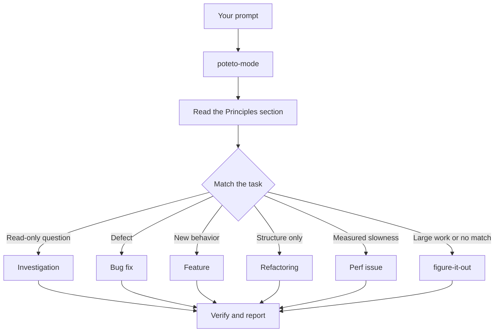

# 让工作走 `/poteto-mode`

`/poteto-mode` 是前门。你给它一个目标，它匹配上二十三个 playbook 中的一个，把那个 playbook 的步骤抄进 todo list，并在步骤需要时调用其他 skill。本页你学一段好 prompt 长什么样，以及你实际需要的那部分能有多小。


## 你的 prompt 会经历什么



这张图画的是常见的几条路径。对于给某个指标做爬坡、诊断运行时 symptom 与抓取下来的 trace、原型、视觉等价、编写与评估 skill、自主运行、开 PR、把 PR 或 stack 照看到可 merge、交付一个已验证的 stack、用 autopilot 跑一个 PR 队列或一个 stack、编排项目级的 program、session pickup、安全暂停、多阶段计划以及 worktree 清理，也都各有 playbook。[playbook 目录](../../skills/poteto-mode/playbooks/)里有全套。

## 说目标，不要说仪式

你不写规格。你说清哪里不对或你想要什么，外加任何你已经知道、能替 agent 省时间的东西：

```text
/poteto-mode users get two notifications after a retry. repro first, then fix and verify.
```

那是一段 Bug fix 的 prompt。「repro first」是一条真实的约束，不是客套话，playbook 会遵守它。看着 todo list 被 Bug fix 的步骤填满。被跳过的步骤会带着 `skip: <reason>` 留在可见处。

## 一段 prompt 里放什么

一段有用的 prompt 最多承载五样东西，每样都只占一句话：

- **目标。** 说清哪里不对，或者你想要什么。
- **完成检查。** 它必须能通过或失败。「做得更好些」和「干一个小时」都不是检查。
- **你想看到的证据。** 要真实的命令输出、一段流程的视频、存下来的值，或一个改前改后的数字。
- **你已经知道的东西。** 一个 symptom、一个 repro 步骤、一行 log，或一个链接，能替 agent 省下一次搜索。
- **真实的约束。** 「repro first」「don't change any code yet」「zero behavior change」和「let me review before proceeding」各自都会改变 agent 的做法。

下面这段 prompt 把五样全占了：

```text
/poteto-mode the csv export drops its last row since yesterday's deploy. failing job id is 4812. repro first, then fix. done means the 60k-row fixture exports every row. show me the row counts before and after.
```

有两样东西值得省掉：

- **怎么做。** 说清要达成什么，给 agent 留出空间去找一条比你选的更好的路。列一串 skill 也一样，下面的陷阱里有讲。
- **你对成因的猜想，至少在开头不要给。** 一旦说出猜测，搜索就被收窄到你指的那个地方。先让 agent 复述问题，再分享你的直觉。

对一份嘈杂的报告，比如一个很长的 thread 或一个含糊的 bug，把复述设成第一步：

```text
/poteto-mode read this thread. restate the underlying issue in your own words, in plain english. don't change any code yet.
```

读错了会在复述里暴露出来，那时还没有任何 code 存在。在那里改掉，代价只是一条 message，而不是一次改错。只要复述、不要 playbook 时，运行 [`/in-your-own-words`](../../skills/in-your-own-words/SKILL.md)。它复述 agent 认为你的目标是什么、你正试图解决什么问题。

当你不确定一段 prompt 是否瞄对了方向，发送前先对它跑一遍 [`/sharpen`](../../skills/sharpen/SKILL.md)：

```text
/sharpen write a migration guide for the v2 config format.
```

agent 会说出一个顶尖专业人士会做而你没要求的事、他们会从什么最原始的素材起步、他们会用的方法与工具，以及除你或 agent 之外还有什么能证明结果是对的。然后它把你的 prompt 重写成恰好要这些东西，更深但不更大，并把你的选择留开着。它不做这个 task。读一遍重写后的版本，再发出去，例如配上 `/poteto-mode`。

## 追问要短

当对话本身已经带着上下文时，prompt 会缩到几乎不存在。下面这些都够用：

```text
/poteto-mode do it
```

```text
continue
```

```text
keep going until done
```

短之所以管用，是因为 playbook 掌握着结构，而 Custom Mode 让 `/poteto-mode` 每一轮都留在上下文里。[安装 pstack](./01-setup.md#run-your-first-task)演示了怎么起一个。你的话承载意图，skill 承载严谨。

## 用「new task」切换任务

一个长 chat 会累积上一个 task 的上下文。当你换了主题，就明说：

```text
/poteto-mode new task. figure out why the cache entry survives logout. don't change any code yet.
```

「new task」告诉 `/poteto-mode` 重新匹配，而不是接着上一个 playbook 走。「don't change any code yet」把这一次钉在 Investigation 上。没有这两个短语，一个正处于 Feature 中途的 mode 往往会把你的问题当成下一个 feature 步骤。

## 给并行的工作各自一台机器

如果你在一台机器上对着一个 repository 跑好几个 agent，它们会争同一个 working tree、同一个端口和同一份 build 输出。最干净的隔离是 [cloud subagent](https://cursor.com/docs/subagents#cloud-subagents)。每一个都拿到自己的 VM 和 branch，于是它能装依赖、跑你的 app、把结果录成视频，而不碰你的机器。在 task 之前输入 `/in-cloud`，或者让父 chat 把活交给 cloud subagent。

当工作必须留在本地时，一开始就要一个 worktree：

```text
/poteto-mode new task. branch off <base> in a fresh worktree, then port the parser change there.
```

每个 task 在自己的 branch 和 worktree 里，意味着没有 agent 会踩到别人的 file。worktree 会占磁盘和机器资源，所以一台笔记本一次只能跑少数几个。[Opening a PR playbook](../../skills/poteto-mode/playbooks/opening-a-pr.md)本来就工作在 worktree 里做 code 改动，所以多数时候你只在某个具体的 base 或位置要紧时才说这句话。

worktree 会越积越多。磁盘紧张时，问一句：

```text
/poteto-mode what's eating my disk? prune the worktrees that are safe to prune.
```

[Worktree cleanup playbook](../../skills/poteto-mode/playbooks/worktree-cleanup.md)按 merge 状态、未提交的工作，以及还有哪些 chat 在碰它，为每个 worktree 分类。它只删那些证据允许删的，对任何还压着未提交工作的，会停下来等你定夺。

## 让它一直跑着

当你走开时，说清「做完」是什么意思，然后走人：

```text
/poteto-mode im stepping away. keep going until the migration check reports zero old callers. log your decisions.
```

你之后要 review 的工作会走 [`/figure-it-out`](../../skills/figure-it-out/SKILL.md)，由它设计这次 run 的各阶段，并维护一份 [`/show-me-your-work`](../../skills/show-me-your-work/SKILL.md) 决策日志。[在你睡觉时继续干活](./07-overnight.md)覆盖完整的隔夜合同。

**陷阱：** 不要在 prompt 里列举 skill（「先 use /how，再 /architect，然后 /arena……」）。playbook 已经把它们的顺序排好了，而手写的顺序往往会打乱或漏掉 playbook 本来会保留的步骤。只有当你想覆盖某个具体选择时，才点名一个 skill。

完整的路由规则读 [`poteto-mode`](../../skills/poteto-mode/SKILL.md) 本身。

下一节：[理解代码](./03-understand.md)。