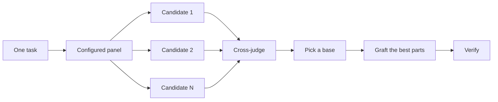

# 写 code 之前先设计

对一道难题只做一次尝试，就把 model 想到的第一个形状锁死了。`/architect` 在实现之前把类型和边界定下来。`/arena` 对同一份 brief 跑好几个尝试，并合并各自最好的部分。`/interrogate` 让其他 model 试着攻破这个结果。当活是覆盖而非设计综合时，`/swarm` 展开各个切片或让几路竞速，并把它们的结果聚合起来。

最常见的两个设计错误，一是直接采用 agent 的第一版设计，二是去打磨一份没有任何 code 检验过的计划。本页两个都治。你通过 code 来做计划。原型回答那些悬着的问题，一份 README 或教程设定目标，而书面的计划放在最后。


## 用 `/architect` 把形状定下来

```text
/architect design the import pipeline before writing any code. i care most about how callers use it.
```

[`/architect`](../../skills/architect/SKILL.md)先把自己接地：对这次设计所触及的 code 跑 `/how`，当它会移动归属或层次时再跑 `/why`。然后它运行 `/arena` 产出互相竞争的设计草图，每份都先写调用方的用法，随后是类型、签名和一张 module map。

默认它从综合出的设计直接进入实现。如果你要先看设计，就明说：

```text
/architect with checkpoint. stop and show me before implementing.
```

code 一旦开始写，设计就不再神圣。如果实现过程中同样的 workaround 出现在不相关的地方，或者类型只有靠 `any` 或强制转换才能编译通过，`/architect` 会把那当作设计错了的证明。它会把草图废掉重新来过，而不是绕着补。

## 用 `/arena` 展开多个尝试

```text
/arena take my prompt to the arena verbatim. i want to compare their proposals with yours.
```

[`/arena`](../../skills/arena/SKILL.md)是底下那个通用工具。N 个 subagent 并行尝试同一份设计或 code brief，各自写进自己的 worktree 或目录。一个来自不同 model 家族的 read-only judge 按 rubric 给每个 candidate 打分。当另一个家族没有 model 可跑时，coordinator 跳过 judge，自己挑 base。coordinator 从头到尾读每个 candidate，挑一个 base，把落选者里最好的想法嫁接进来，并核实结果。



这个 panel 来自你的 [`/setup-pstack`](../../skills/setup-pstack/SKILL.md) 配置，你也可以按 task 调整。这个决定要紧时就要更多 candidate，不要紧时就少要几个：

```text
/arena this, 5 candidates. the cache key format is expensive to change later.
```

## 用 `/swarm` 覆盖切片与竞速

```text
/swarm check every package under packages/ against its check.sh. one worker per package. one report.
```

[`/swarm`](../../skills/swarm/SKILL.md)把 N 个 worker 铺到互相独立的切片、覆盖矩阵、gauntlet 跑道、探索分区，或事先声明的竞速臂上。每个 worker 拿到自己的作用域与检查，然后报 `PASS`、`ISSUES` 或 `BLOCKED`。父级等这些 worker 结束，交回一份紧凑的报告，并列出任何缺口或掉队者。

当并行能换来覆盖，或能让互相独立的检查竞速时，就用它。`/arena` 给每个 worker 同一份设计或 code brief，然后挑一个 base 并嫁接最好的部分。`/swarm` 覆盖各个切片，或跑一场事先声明了选取规则的竞速。它不搞挑 base 与嫁接那一套仪式。

## 用 `/interrogate` 攻破它

```text
/interrogate the whole branch, but skeptically. no nitpicks unless it's an actual bug or regression.
```

[`/interrogate`](../../skills/interrogate/SKILL.md)把这次改动及其意图交给配置好的 model 上的对手，每一个都对着真实 code 跑一次，试着攻破它。不同的对手会找到不同的失败。一个 finding 只有在重跑它的命令显示出破坏意图的失败时才成立。报告会列出每一条被证实的 finding 及找到它的对手，然后列出每个对手丢弃了什么、为什么，并且不做任何应用。

也读一读那条 Dropped 列表。你可以推翻这个裁定。

## 拿原型代替辩论

绝不要采用第一版设计。要几个，并从你看得见的证据里挑：

```text
/poteto-mode prototype a few options for the new dropdown menu. take screenshots or videos for me to compare.
```

[Prototype playbook](../../skills/poteto-mode/playbooks/prototype.md)在一个临时目录里搭出用完即弃的草图，把各个变体放进同一个切换器后面，逐个驱动，并抓下截图或计时。它对行为与算法同样管用，不只是 UI。原型就是用 code 做计划。它们让 agent 靠跑起来点什么来回答自己那些悬着的问题，而不是来问你，而且为你想不到的那个选项留了空间。

同一个思路可以放大到真实的设计上。把 `/architect` 与原型配上，并留一道 review 闸：

```text
/poteto-mode we need rate limiting for external webhooks. /architect it first, and answer open questions with prototypes. let me review before proceeding.
```

不要把对手浪费在一份抽象的计划上。`/interrogate` 会丢弃每一个未能被一次运行证实的 finding，所以一份背后没有 code 的计划，几乎没什么可让它们攻破的。让原型把问题定下来，再去 review 实际建出来的东西。

## 共享 code 先写 README

对于一个别的 code 会用的 package 或 API，从使用者会读的那份文档写起：

```text
/poteto-mode write a tutorial for how i would use the new config package first. then /teach me why it beats the current one.
```

先写教程会迫使你站在调用方的视角。你向一个假想的 user 描述这个 API，再倒推回实现。这份文档还成了一个具体的目标，agent 可以拿它核对自己的工作。当文档本身要紧时，点名 [`/technical-writing`](../../skills/technical-writing/SKILL.md)，好让一份教程始终是教程，而不是漂成一锅 reference 加 explanation。

## 等设计定下来之后再计划

pstack 有意不提供规划类 skill。当你确实想要一份书面计划时，等设计定下来再要：

```text
/poteto-mode turn this design into a plan. small verifiable PRs, each with its own verification steps.
```

[Multi-phase plan playbook](../../skills/poteto-mode/playbooks/multi-phase-plan.md)用原型把任何剩下的悬而未决之处定下来，然后每个 PR 写一节，每一节都以「这次改动有效」的证明结尾。光是一套通过的测试不算那种证明。计划本身就是交付物。该 playbook 不实现它，并会点名接下来该由哪个执行 playbook 来跑它。

对一次迁移，把标准写进 prompt：

```text
/poteto-mode plan the migration of our ui library to the new styling system. small verifiable PRs, each with visual regression checks. the result must match the original exactly, bugs included.
```

「bugs included」能防止这次迁移在路上悄悄把东西修好——那会让新旧输出无法比较。对一个跨越许多天的项目，你可以把这份计划在 repo 里 commit 一段时间，让其他 agent 看见这项工作的进行。等工作落地后把它删掉。

## 一个 task 值得多少设计工作？

你也许会想，是不是每个改动都需要这些。不。大多数改动一点也不需要。下面是一道粗略的阶梯：

- 一个小的、已完成的改动，而你又不确定，只需要 `/interrogate`。
- 一个跨函数边界或移动归属的改动，值得上 `/architect`，而它会把 `/arena` 一并带来。
- 一个独立的决定，且互相独立的尝试会有帮助，比如命名、格式或算法，直接就是 `/arena`。
- 一张覆盖矩阵、一组并行检查，或一场声明了各臂的竞速，是 `/swarm`。
- 一个你能靠跑点什么来回答的悬着的问题，比如一处布局、一个时序或一种做法，用原型，不要辩论。
- 一个尚有争议且反向代价高昂的设计，先 `/architect`，交付前再 `/interrogate`。
- 跨好几个 PR 的工作，要一份计划，写在设计定下来之后。

`/poteto-mode` 已经应用了这道阶梯。跨边界的工作会自己触发 `/architect`，所以你直接调用这些工具，主要是在你想要比默认更多或更少的审视时。

下一节：[实现并清理这次改动](./05-build-and-clean.md)。