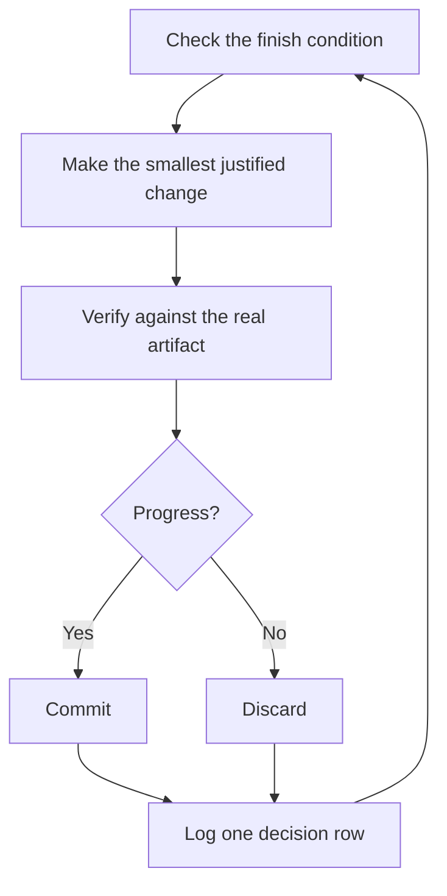

# 在你睡觉时继续干活

这是前面一切内容的回报。一个你能信任它自证工作的 agent，就是一个你能撒手不管、交给它一道硬任务的 agent。让这件事安全的不是希望。它是一条可核查的完成条件、一个隔离的 worktree 或 cloud agent，以及一份你早上来审计的决策日志。


## 在开循环之前先挣得那份信任

一个你不信任的循环，只会更快地产出未经检查的工作，而混乱会随每一次迭代叠加。在你放任一个循环跑之前，先确认它挣得了这份信任：

- 你已经手工做过一次这个 task，或者看过一个 agent 做过，所以你知道「好」长什么样。
- 这个 agent 有你自己会用的那些工具与信号：那个验证 skill、那个 profiler、那些日志。
- 每个阶段都证明自己的工作，并在工作未达标时能叫停整条线。
- 你读过几份 transcript，并把反复出现的失败变成了工具、skill 或检查。

只有这四条都成立之后，才让循环自主运行。在那之前，让它在你眼皮底下跑。

## 隔夜合同

一份好的交接有目标、完成条件、权限，以及一条逃生舱口。它不需要很长：

```text
/poteto-mode im going to bed. migrate every caller to the new parser in a fresh worktree off <base>.
done means zero old callers, all parser fixtures pass, old api deleted.
keep a decision log. don't ask me before committing.
/loop until done. if you're truly stuck after a few hours, stop and write up why.
```

逐行看看每一句给你换来了什么：

- 「im going to bed」是一次 session 级覆盖。agent 不再来问，继续往下走。
- 「done means...」把目标变成每一次迭代都能跑的检查。
- 「fresh worktree off `<base>`」让这次运行不会与你开着的任何别的东西相撞。
- 「don't ask me before committing」预先回答了 agent 否则会卡住的那个许可。
- `/loop` 是 Cursor 内置的唤醒机制，不是 pstack 的 skill。[Autonomous run playbook](../../skills/poteto-mode/playbooks/autonomous-run.md)用它来在事件或心跳上重新检查完成条件。
- 逃生舱口让它在真正的死胡同时停下并写明原因，这胜过八小时创造性地重新诠释目标。

因为你要在走开之后 review 这些工作，`/poteto-mode` 会让它走 [`/figure-it-out`](../../skills/figure-it-out/SKILL.md)，由它在任何 code 之前设计这次 run 的各阶段，并把决策日志接进去。

要主动停下一个 run，就告诉 agent 暂停，或者告诉它你即将离线或重启 Cursor。[Pause safely playbook](../../skills/poteto-mode/playbooks/pause-safely.md)会完成或撤回当前这一步，提交一个进行中的 checkpoint，并写一份恢复说明。一个新的 chat 通过 Session pickup playbook 从那份说明把工作接起来。说「keep going」永远不会触发暂停。

## 循环整夜都在做什么



一次改动、一次检查、一行日志，每一次迭代都如此。没有帮助的改动会被丢弃，而不是留着搭便车。一段平台期意味着转向，而不是停下，而完成条件永远不会悄悄放宽来宣布胜利。

## 早上的审计

[`/show-me-your-work`](../../skills/show-me-your-work/SKILL.md)是让这次 run 可 review 的东西。每一行记录时间、阶段、决定、理由、一个证据指针和结果，放在 `decisions.tsv` 这个 TSV 里（当多个 run 共用一个目录时则放在 `.audit/<task-slug>.tsv`）。默认它留在本地。当这项工作足够有野心、reviewer 需要这条轨迹才能信任结果时，把它 commit。

当你回来时，用 review 的形式要这次 run：

```text
/show-me-your-work catch me up on what you did last night
```

在该 skill 交回它的摘要之前，它会起一个来自不同 model 家族的 reviewer 去读这条轨迹和 transcript，而 reply 以一段 Attention 节收尾，列出哪些值得你细看。先读那一节，再读它指向的那些日志行。你审计的是决定，而不是重读整晚。

要一个快速状态而非一次审计时，就在跑这项工作的那个 chat 里运行 [`/ketchup`](../../skills/ketchup/SKILL.md)。它只读，并用平实的话告诉你自你上一条 message 以来变了什么，附上这项工作产出的截图和小图。然后它列出每一项在等你的决定，例如一次 merge、一次批准，或几个选项之间的取舍，并带上它的选择、证据和风险，让你仅凭这条 reply 就能定夺。

## 当这一夜装的是一条队列，而不是一个 task

上面的合同把一个 task 推到一个完成条件。有些夜晚装得更多：一条互相独立改动的队列，或者一整个 program。有三个 playbook 把同一份信任放大。

[Autopilot-full](../../skills/poteto-mode/playbooks/autopilot-full.md)把一条互相独立的 PR 队列跑到已 merge。每个 PR 得到一个 owner agent，由它把该 PR 从构建一路带到 merge，而没有哪个 owner 能凭自己的裁定去 merge。一群全新的 verifier 检查 owner 那版本已就绪的 code。后来的 rebase 或小修复只换一个全新的 verifier，只有新行为或一份很大的新 diff 才需要再把整个 swarm 叫来。只有当那个要 merge 的 patch 拿到干净裁定时，merge 才被授权：

```text
/poteto-mode full autopilot on this queue. each item is independent. i want them merged by morning.
```

[Autopilot-stack](../../skills/poteto-mode/playbooks/autopilot-stack.md)是去掉 merge 的 Autopilot-full。你醒来时得到已验证的 PR，各自带着裁定，由你自己 review 和落地。一个 PR 只叠在它所基于的那个 PR 上。当你想在任何东西 merge 之前亲眼过一遍时，选它而不是 Autopilot-full：

```text
/poteto-mode autopilot these five changes, but don't merge. i'll land them in the morning.
```

[Orchestrate](../../skills/poteto-mode/playbooks/orchestrate.md)是给那种活得比任何单个 agent 都久的 program 用的：多天、许多 stacked PR、在一个常驻 coordinator chat 之下成群的 subagent。coordinator 决定每一块活由哪个 agent 做、检查每一个产出的东西，而它自己绝不写 code。如果一个 agent 在一个 session 里就能干完，该 playbook 本身会把你路由回上面那份隔夜合同：

```text
/poteto-mode orchestrate the store migration. own it until every package is converted and merged. i'll check in twice a day.
```

## 并行跑许多项目

一个 [Cursor Project](https://cursor.com/blog/projects)给一个 coordinator agent 一条常驻 thread。coordinator 不写 code。它指挥 subagent，而这些默认在 cloud 里跑，所以你合上笔记本时工作仍在继续。这正是 Orchestrate playbook 所期待的形状。给 coordinator 的 prompt 以 `/poteto-mode` 开头，它起的那些 subagent 就会遵循那些 playbook。

有几个习惯会有帮助：

- 给每一摊工作各自一个 Project，例如一个 feature、一次迁移、一轮 perf 攻坚，或一次技术债清理。好几个可以并排跑。
- 把相关的 chat 拖进这个 Project，已完成的也算。它们会成为其中每个 agent 的上下文。
- 给每个 PR 在 merge 之前配一群 verifier，并让 Autopilot-stack 或 Autopilot-full 带动这条队列。
- 向 coordinator 要一份有数据支撑的计划，并让它在来问你之前用原型回答那些悬着的问题。

一段 prompt 可以承载一整个 Project，从研究一路到执行：

```text
/poteto-mode refactor this repo so its architecture is more agent friendly. use /correct and /architect on past commits and review comments to find the mistakes agents make most here. use /recall for context from past chats. answer open questions with prototypes instead of asking me. come back with a plan backed by real data. once i approve it, run it with autopilot-stack or autopilot-full, and ask me which.
```

## 让循环自己启动

上面每一个循环都还在等你去启动它。一个定时的或事件驱动的 automation 去掉了这一步。软件维护可以拆成很适合这件事的几个阶段：分流一份报告、复现它、修好它、验证这个修复。有两条规则让这样一条产线值得信任：

- 每个阶段都能叫停整条线。分流可以判定这份报告是预期行为，复现可以复现不出来，修复者可以判定这个改动风险太大。这些结果每一种都有用，因为它挡住了坏工作流向下一个阶段——在那里再撤销代价更高。
- 每个阶段都交接证据。复现附上损坏状态的截图和视频，修复附上改前改后的证明。这样人就能在读一行 code 之前，先检查 agent 修的是不是对的东西。

pstack 把它作为一份休眠的 [automation pack](https://github.com/cursor/plugins/tree/main/pstack/automations/benny) 随附，用于 Slack 的 issue report。一个 automation 分流每份报告。另一个复现已确认的 bug，并可能准备一份小的草稿修复。让一个 agent 指向它的 [`FOR_AGENTS.md`](https://github.com/cursor/plugins/blob/main/pstack/automations/benny/FOR_AGENTS.md) 并点名目标 repository 来配置它。

**陷阱：** 一段时长不是完成条件。「在这上面干 4 小时」没给 agent 任何可检查的东西，而你会醒来面对四个小时的动作，而不是一个结果。给 `/loop` 一个能通过或失败的谓词。

下一节：[用原则的名字来掌舵](./08-principles.md)。