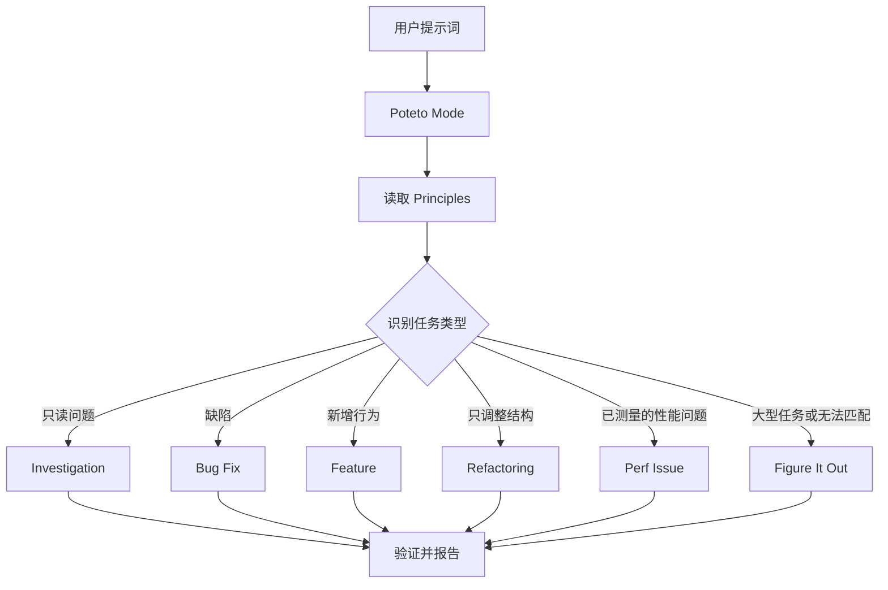

# 第 2 章：通过 Poteto Mode 路由任务

> 来源：[上游 02-poteto-mode.md](https://github.com/cursor/plugins/blob/main/pstack/docs/guide/02-poteto-mode.md)。以下为中文翻译与必要术语解释。

## 1. Poteto Mode 是任务入口

`/poteto-mode` 是 P-Stack 的主要入口。你告诉它目标，它会从 23 个 Playbook 中匹配合适的流程，把该流程的步骤复制到待办清单，并在每个步骤需要时调用其他 Skills。

本章要讲的是：怎样写出有效提示词，以及实际需要写多少内容。通常并不需要一份很长的规格说明。

## 2. 提示词会经历什么

典型路由过程如下：



除图中常见路径外，还有用于指标持续优化、运行时诊断、性能追踪分析、原型设计、视觉一致性、Skill 编写与评估、自主运行、PR 创建与跟进、验证后交付、自动化 PR 队列、项目级编排、会话接续、安全暂停、多阶段计划和 Worktree 清理的 Playbook。完整列表见[上游 Playbook 目录](https://github.com/cursor/plugins/tree/main/pstack/skills/poteto-mode/playbooks)。

## 3. 说清目标，不必描述仪式

你不必先写一份正式规格。只需说明哪里不对、希望得到什么，以及任何能节省 Agent 时间的已知信息。

示例：

```text
/poteto-mode users get two notifications after a retry. repro first, then fix and verify.
```

这是一个 Bug Fix 任务。“先复现”是明确约束，不是客套话，Playbook 应遵守它。观察待办列表，Bug Fix 的步骤会逐项出现。被跳过的步骤仍会保留，并标注 `skip: <reason>`，这样你能看见流程跳过了什么以及原因。

## 4. 一个有效提示词包含什么

一个实用提示词最多可包含五类信息，每类通常一句话就够：

1. **目标（Goal）**：说明哪里有问题，或希望实现什么。
2. **完成判据（Done check）**：必须能够判断通过或失败。“做得更好”或“工作一个小时”不是可验证的判据。
3. **希望看到的证据（Proof）**：要求提供真实命令输出、操作视频、持久化后的值，或前后对比数据。
4. **已知信息（Known context）**：症状、复现步骤、日志行或链接，都能减少无效搜索。
5. **真实约束（Constraints）**：例如“先复现”“暂时不要改代码”“行为必须零变化”“继续前让我审查”。这些约束会改变 Agent 的执行方式。

包含五类信息的示例：

```text
/poteto-mode the csv export drops its last row since yesterday's deploy. failing job id is 4812. repro first, then fix. done means the 60k-row fixture exports every row. show me the row counts before and after.
```

有两类内容通常不必提前写入：

- **具体怎么做**：说明目标即可，给 Agent 留出寻找更好路径的空间。不要机械列出必须调用哪些 Skills。
- **你对根因的猜测**：一开始就给出猜测，可能把搜索范围限制在你指出的位置。先让 Agent 用自己的话复述问题，再提供你的猜测。

如果问题报告很混乱，例如一长串讨论或模糊的 Bug，可以先要求 Agent 复述问题：

```text
/poteto-mode read this thread. restate the underlying issue in your own words, in plain english. don't change any code yet.
```

在修改代码前先复述，能及早暴露理解偏差。只需要复述、不需要启动 Playbook 时，可以使用 `/in-your-own-words`。它会说明 Agent 认为你的目标和待解决问题是什么。

如果不确定提示词是否足够准确，可以先用 `/sharpen`：

```text
/sharpen write a migration guide for the v2 config format.
```

它会分析专业人员可能采取但你尚未提出的做法、最原始的输入材料、可用方法和工具，以及如何独立验证结果；随后把提示词改写得更深入但不扩大范围，并保留你的决策空间。`/sharpen` 只改进提示词，不会替你执行任务。检查改写结果后，再将它交给 `/poteto-mode` 等入口执行。

## 5. 上下文已经充分时，后续指令可以很短

当对话已经包含任务上下文时，后续只说：

```text
/poteto-mode do it
```

或：

```text
continue
```

或：

```text
keep going until done
```

之所以有效，是因为 Playbook 保存了流程结构；如果把 `/poteto-mode` 作为 Custom Mode 持续启用，它会在每轮对话中保持上下文。如何启用见[安装指南](https://github.com/cursor/plugins/blob/main/pstack/docs/guide/01-setup.md)。

## 6. 切换任务时明确说“new task”

长对话会积累上一个任务的上下文。开始不同主题时，应明确声明：

```text
/poteto-mode new task. figure out why the cache entry survives logout. don't change any code yet.
```

`new task` 表示重新匹配 Playbook，而不是继续之前的流程；`don't change any code yet` 则把当前任务限定为调查。如果不声明新任务，处于 Feature 流程中的 Mode 可能把你的问题误判为该功能的下一步。

## 7. 并行任务必须隔离执行环境

如果多个 Agent 在同一台机器、同一个仓库中工作，它们可能争抢工作树、端口和构建产物。

上游建议优先考虑 Cloud Subagent：每个 Agent 拥有独立 VM 和分支，可以安装依赖、运行应用、记录视频，而不会修改你的本地环境。也可以在任务前使用 `/in-cloud`，或让父 Agent 将工作交给 Cloud Subagents。

必须在本地执行时，提前指定独立 Worktree：

```text
/poteto-mode new task. branch off <base> in a fresh worktree, then port the parser change there.
```

每个任务使用自己的分支和 Worktree，可以避免 Agent 覆盖其他 Agent 的文件。但 Worktree 会占用磁盘和机器资源，一台笔记本通常只能同时运行少量实例。

当磁盘空间紧张时，可以让 Agent 检查哪些 Worktree 可以安全清理。上游 Worktree Cleanup Playbook 会根据合并状态、未提交改动和仍在使用该 Worktree 的会话进行分类；只有证据允许时才删除，存在未提交工作的情况需要暂停并交由用户决定。

## 8. 离开电脑时，明确完成条件

如果你要暂时离开，可以这样交代：

```text
/poteto-mode im stepping away. keep going until the migration check reports zero old callers. log your decisions.
```

此类任务会进入 `/figure-it-out` 流程，设计执行阶段并维护 `/show-me-your-work` 决策日志。完整的长时间自主运行约定见[第 7 章](https://github.com/cursor/plugins/blob/main/pstack/docs/guide/07-overnight.md)。

## 9. 常见陷阱：不要在提示词里罗列 Skills

不要写成“先调用 /how，再调用 /architect，然后 /arena……”。Playbook 已经负责步骤排序。手动列举 Skills 反而容易改变或遗漏原流程中的步骤。只有当你确实希望覆盖某个具体选择时，才直接点名 Skill。

要理解完整路由规则，应继续阅读上游的 [poteto-mode/SKILL.md](https://github.com/cursor/plugins/blob/main/pstack/skills/poteto-mode/SKILL.md)。

---

## 本章解读：对多模型工作台的意义

1. 用户输入应聚焦目标、完成判据和证据，不应被迫学习内部 Skill 调度细节。
2. Orchestrator 必须区分“继续当前任务”和“开始新任务”，避免旧上下文污染新工作。
3. 并行 Agent 必须有独立工作区、输出路径和验收条件。
4. 工作流应显式显示被跳过的步骤及原因。
5. 提示词优化与任务执行应是两个不同动作，避免用户只是想改写提示词却意外启动昂贵任务。

这些是对 P-Stack 方法的迁移建议，并非其他 Agent 运行时已经原生具备这些能力。
