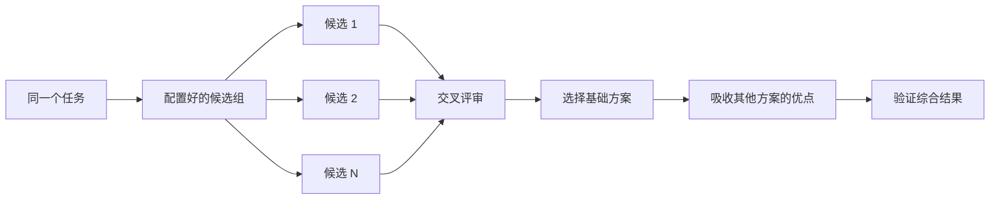

# 第 4 章：先设计，再编写代码

> 来源：[上游 04-design.md](https://github.com/cursor/plugins/blob/main/pstack/docs/guide/04-design.md)。

复杂设计只尝试一次，容易过早锁定模型想到的第一个方案。P-Stack 使用：
- `/architect`：在实现前确定类型和边界；
- `/arena`：让多个 Agent 对同一任务独立尝试，再综合最佳部分；
- `/interrogate`：让其他模型尝试推翻设计或实现；
- `/swarm`：当目标是覆盖多个工作切片而不是综合设计时，拆分任务并行执行。

常见设计错误有两个：直接接受 Agent 的第一个方案；或者反复润色一个从未通过代码验证的计划。P-Stack 倾向于“通过代码推进设计”：用原型回答开放问题，用 README 或教程明确目标，最后再写计划。

## 1. 使用 /architect 确定整体形态

示例：

```text
/architect design the import pipeline before writing any code. i care most about how callers use it.
```

`/architect` 首先建立真实系统上下文：
- 对涉及的代码运行 `/how`；
- 如果设计会改变所有权或分层，再运行 `/why`；
- 然后运行 `/arena`，生成相互竞争的设计草图。

每个设计草图先写调用者如何使用接口，再列出类型、函数签名和模块映射。

默认情况下，综合设计完成后会直接进入实现。如果希望先审查设计，可以明确要求：

```text
/architect with checkpoint. stop and show me before implementing.
```

设计草图不是不可更改的圣旨。如果实现过程中发现多个无关位置都需要相同的临时绕过方案，或者类型只能靠 `any`、强制类型转换才能编译，P-Stack 会把它视为设计可能有误的证据，重新设计，而不是不断打补丁。

## 2. 使用 /arena 并行探索方案

示例：

```text
/arena take my prompt to the arena verbatim. i want to compare their proposals with yours.
```

`/arena` 让 N 个子 Agent 并行执行同一份设计或编码任务，每个候选使用独立 Worktree 或目录。只读 Judge 根据评分标准评价候选；在可行时，Judge 使用与主模型不同的模型家族。

如果无法运行其他模型家族的 Judge，协调者会跳过交叉评审，并自行选择基础方案。协调者需要完整阅读所有候选结果，选出一个作为基础，吸收其他候选的优点，再验证最终结果。



候选模型组由 `/setup-pstack` 配置。可以按任务重要程度调整数量：

```text
/arena this, 5 candidates. the cache key format is expensive to change later.
```

## 3. 使用 /swarm 覆盖不同任务切片

示例：

```text
/swarm check every package under packages/ against its check.sh. one worker per package. one report.
```

`/swarm` 可以把 N 个工作者分配到独立目录、覆盖矩阵、测试通道、探索分区或预先声明的竞赛任务中。每个工作者都有自己的范围和检查方法，最终返回 `PASS`、`ISSUES` 或 `BLOCKED`。父 Agent 等待结果并统一报告遗漏和退出的工作者。

Arena 与 Swarm 的区别：
- Arena：所有候选执行相同任务，最终选择一个基础方案并吸收其他方案的优点。
- Swarm：主要用于覆盖不同切片，或按预先声明的规则进行竞赛；没有 Arena 那套基础方案选择和合并流程。

## 4. 使用 /interrogate 尝试推翻结果

示例：

```text
/interrogate the whole branch, but skeptically. no nitpicks unless it's an actual bug or regression.
```

`/interrogate` 将变更范围和用户意图交给多个对抗者。每个对抗者都必须通过真实代码运行来证明问题，例如失败测试、复现脚本或能够显示错误行为的命令输出。

只有重新运行后仍能证明失败、且失败确实违背预期行为的发现才能保留。报告会列出全部已验证问题、发现它们的 Agent，以及被丢弃的问题和原因。该 Skill 只报告问题，不应用修复。

应同时阅读 Dropped 列表，必要时可以质疑评估结论。

## 5. 用原型代替无休止的争论

不要只接受第一个设计。可以要求 Agent 先做几个原型，再用可观察证据比较：

```text
/poteto-mode prototype a few options for the new dropdown menu. take screenshots or videos for me to compare.
```

Prototype Playbook 会在临时目录中创建可丢弃的草图，通过统一切换入口展示不同变体，实际驱动每个变体，并采集截图或耗时。它不仅适用于 UI，也适用于行为和算法。

原型是“用代码做规划”：Agent 可以通过运行实验回答开放问题，而不是把所有问题都抛给用户；同时也可能发现用户最初没想到的选项。

对于真正的系统设计，可以把 Architect 和原型结合，并设置人工审查点：

```text
/poteto-mode we need rate limiting for external webhooks. /architect it first, and answer open questions with prototypes. let me review before proceeding.
```

不要对没有代码支撑的抽象计划投入大量对抗审查。Interrogate 会丢弃所有无法通过运行证明的问题；没有实现或原型时，可供它验证的内容很少。应先用原型解决开放问题，再审查实际产物。

## 6. 对共享代码，先写 README 或教程

如果要设计其他代码会使用的包或 API，可以先写用户真正会阅读的文档：

```text
/poteto-mode write a tutorial for how i would use the new config package first. then /teach me why it beats the current one.
```

先写教程能迫使设计者从调用者角度思考 API，再反向推导实现。文档也成为 Agent 检查自身工作的具体目标。若文档质量本身很重要，可以明确调用 `/technical-writing`，避免教程同时变成参考手册和泛泛解释。

## 7. 设计稳定后再写计划

P-Stack 有意不提供一个独立的通用 Planning Skill。若确实需要书面计划，应等设计稳定后再生成：

```text
/poteto-mode turn this design into a plan. small verifiable PRs, each with its own verification steps.
```

Multi-phase Plan Playbook 会先用原型解决剩余开放问题，再按 PR 拆分计划。每个阶段都必须有自己的验证步骤。仅仅通过测试套件不算充分证明。计划是交付物本身；该 Playbook 不负责实现，并会指出下一步应该使用哪个执行 Playbook。

对于迁移，可以明确规定验收标准。例如要求视觉回归检查，甚至要求新旧行为完全一致（包括原有 Bug），避免迁移过程中混入额外行为变化，导致无法比较。

跨越多天的项目可以把计划提交到仓库，供其他 Agent 了解进行中的工作；任务完成后应删除临时计划。

## 8. 不同任务需要不同程度的设计工作

并非每个变更都需要完整设计流程：

- 小型且已完成、但不确定是否安全的改动：使用 `/interrogate`。
- 跨越函数边界或改变所有权的改动：使用 `/architect`，它会进一步调用 `/arena`。
- 需要独立方案比较的单点决策（名称、格式、算法）：直接使用 `/arena`。
- 覆盖矩阵、并行检查或有明确候选规则的竞赛：使用 `/swarm`。
- 可以通过运行观察回答的问题（布局、耗时、行为）：先做原型，不要只争论。
- 难以回滚且存在争议的设计：先 `/architect`，再在交付前 `/interrogate`。
- 跨多个 PR 的工作：设计稳定后再写计划。

`/poteto-mode` 已经应用了这套分级策略。直接调用这些 Skill，主要用于你希望比默认流程增加或减少审查力度的情况。

---

## 本章解读：对工作台的设计建议

建议把“并行执行”拆成三个独立操作：
- **Race / Arena**：相同任务、不同候选、同一评分尺度、独立评审。
- **Partition / Swarm**：不同任务切片、明确所有权、汇总覆盖率。
- **Adversarial Review / Interrogate**：只负责找可复现的问题，不直接修改。

此外，设计阶段的开放问题应优先用原型验证。不要把能通过运行得到答案的问题转交给用户猜测。
