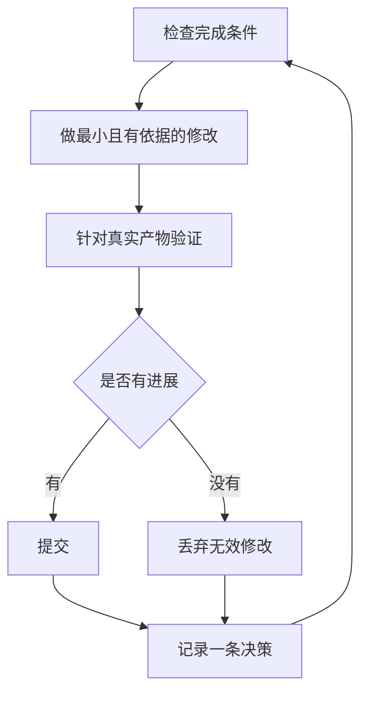

# 第 7 章：让 Agent 在你休息时持续工作

> 上游来源：[docs/guide/07-overnight.md](https://github.com/cursor/plugins/blob/main/pstack/docs/guide/07-overnight.md)

这是前面所有工程纪律带来的收益：一个能够验证自己工作的 Agent，才可能被放心地交给复杂任务并在无人看守时继续执行。

安全自主运行的基础不是“相信模型”，而是：可检查的完成条件、隔离的 Worktree 或云端 Agent，以及第二天可以审计的决策日志。

## 1. 循环执行前先建立信任

不可信的循环只会更快地产生未经检查的工作，错误还会随着迭代累积。让 Agent 自主运行前，应确认：

- 你自己已经执行过一次任务，或者看过 Agent 执行，知道正确结果是什么。
- Agent 拥有你自己会使用的工具和信号，例如验证 Skill、性能分析器和日志。
- 每个阶段都会验证自己的产物；不满足标准时能够停止流水线。
- 你已经阅读过若干执行 Transcript，并把重复失败转化为工具、Skill 或检查项。

只有这四项都满足，才适合放开自主循环。在此之前，应当边看边运行。

## 2. 设计 Overnight Contract

一个合格的任务交接应包含：目标、完成条件、权限和退出机制。示例：

```text
/poteto-mode im going to bed. migrate every caller to the new parser in a fresh worktree off <base>.
done means zero old callers, all parser fixtures pass, old api deleted.
keep a decision log. don't ask me before committing.
/loop until done. if you're truly stuck after a few hours, stop and write up why.
```

每一项都有明确作用：

- “im going to bed”表示本次会话允许 Agent 在不逐步询问的情况下继续执行。
- “done means...”把目标变成每轮都能检查的条件。
- “fresh worktree”使任务与其他工作区隔离，避免互相覆盖。
- “don't ask me before committing”明确授予提交权限，减少无谓等待。
- `/loop` 是 Cursor 自带的唤醒机制，不是 P-Stack Skill。Autonomous Run Playbook 利用它按事件或心跳重新检查完成条件。
- 退出机制让 Agent 在真正受阻时停止并说明原因，避免长时间偏离目标。

由于用户可能在任务结束后才审查结果，Poteto Mode 会把这类工作路由到 Figure It Out 流程，先设计阶段并建立决策日志。

需要主动暂停时，应明确告诉 Agent 暂停，或说明即将离线、重启 Cursor。Pause Safely Playbook 会完成或回滚当前步骤、创建 WIP 检查点并写恢复说明；新会话再通过 Session Pickup 接管。单纯说“继续”不会触发暂停。

## 3. 每轮循环做什么



每轮只做一项修改、一次验证和一条日志记录。没有收益的改动应丢弃，而不是带入后续迭代。遇到平台期应调整假设或方法，但不能悄悄降低完成标准来宣布成功。

## 4. 第二天如何审计

`/show-me-your-work` 用于审计执行过程。每条记录包含时间、阶段、决策、原因、证据位置和结果，默认写入本地 TSV：

```text
decisions.tsv
```

多个任务共享目录时，可以使用：

```text
.audit/<task-slug>.tsv
```

默认保持本地；只有任务规模足以让审查者需要完整轨迹时，才考虑提交到仓库。

第二天可以执行：

```text
/show-me-your-work catch me up on what you did last night
```

该 Skill 会安排不同模型家族的审查者阅读决策轨迹和 Transcript，并在回复末尾给出 Attention 部分，指出需要重点审查的决策。应先阅读 Attention，再检查它指向的日志行。

如果只需要快速了解状态，可以在原会话中执行 `/ketchup`。它只读地总结自上次消息以来的变化，并列出等待用户处理的合并、批准或方案选择，以及相应证据和风险。

## 5. 从单个任务扩展到任务队列

单个 Overnight Contract 解决的是一个目标。若要处理多个独立变更或长期项目，上游提供三种不同规模的流程：

### Autopilot-full

将独立 PR 队列自动推进到合并。每个 PR 有一个负责从开发到交付的 Owner Agent，但 Owner 不能只凭自己的判断授权合并。新的验证 Agent 会检查代码就绪的提交；后续 Rebase 或小修复需要新的验证，只有最终合入的 Patch 获得干净验证结果后才允许合并。

### Autopilot-stack

与 Autopilot-full 类似，但不执行合并。Agent 准备并验证 PR，用户第二天自行审查和合入。若希望保留最终人工决策，应选择这种方式。

### Orchestrate

适用于跨多天、多个堆叠 PR 和大量子 Agent 的长期项目。一个常驻协调会话分配任务、检查产物，但协调者本身不写代码。如果一个 Agent 能在单次会话完成任务，就不需要使用如此复杂的编排。

## 6. 并行运行多个项目

Cursor Project 为协调 Agent 提供持久会话。协调者负责指挥子 Agent，而不直接写代码；子 Agent 默认可以在云端运行，因此用户关闭笔记本后工作仍可继续。这是 Orchestrate Playbook 预期的工作形态。

建议：
- 每个独立工作主题使用自己的 Project，例如功能开发、迁移、性能优化或技术债治理。
- 将相关历史会话加入 Project，作为后续 Agent 的上下文。
- 每个 PR 合并前安排独立验证。
- 让协调者提供基于数据的计划，并用原型解决可实验的问题，而不是把所有问题都交给用户猜。

## 7. 让循环自动启动

定时或事件驱动自动化可以免去人工启动每轮任务。以 Slack 缺陷报告为例，可以拆为：

1. Triage：判断报告是否是真实问题、是否值得继续。
2. Repro：复现确认的 Bug。
3. Fix：准备小范围修复。
4. Verify：证明修复有效。

两条原则不可缺少：

- 每个阶段都有权停止流水线。例如报告属于预期行为、无法复现、修复风险过高，都应停止向下一阶段传递。
- 每个阶段交接证据。复现阶段提供故障截图或视频，修复阶段提供前后对比证据，让人工能够先判断是否修复了正确问题，再阅读代码。

上游提供了一个休眠状态的 Benny 自动化包，用于 Slack Issue 报告。具体配置应以对应的自动化说明为准。

**陷阱：**“工作四小时”不是完成条件。Agent 需要的是可以通过或失败的谓词，而不是一个持续时间。

## 本章解读：适用于本地 Codex 工作台的安全边界

云端持续运行与本地 WSL 执行不能简单等同。我们的本地工作台若实现长任务，应额外具备：

- 独立 Git Worktree / 分支；
- 允许执行的命令白名单或审批策略；
- 明确的文件写入范围；
- 最大运行时长、Token 和费用预算；
- 失败次数与重试上限；
- 可随时停止和恢复的检查点；
- 决策日志和命令输出；
- 提交、推送、合并等高影响动作的权限门禁。

默认建议：允许 Agent 在隔离 Worktree 中读写和运行测试；提交前可按任务授权；推送、合并、删除分支、修改生产环境等操作应保留明确审批。
